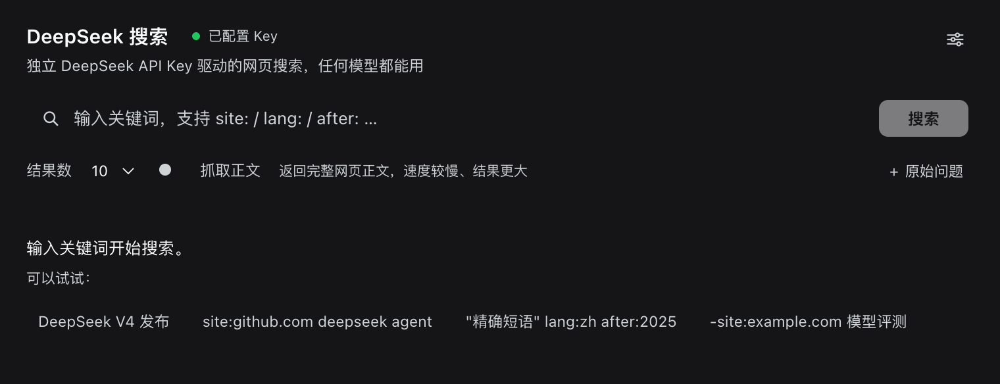
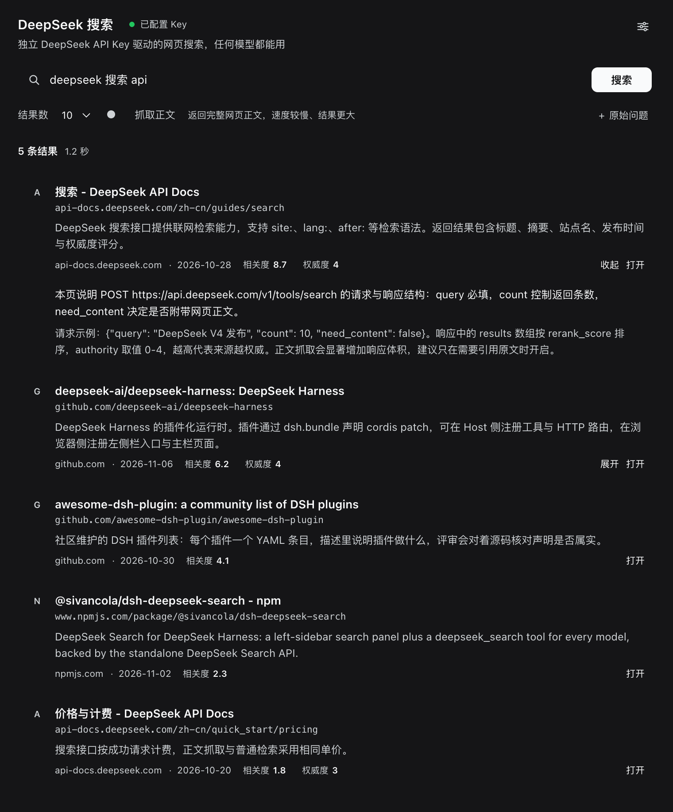
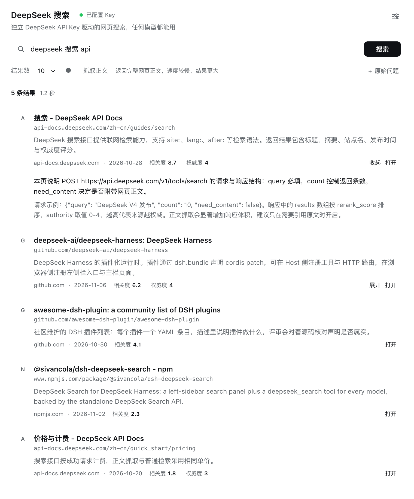
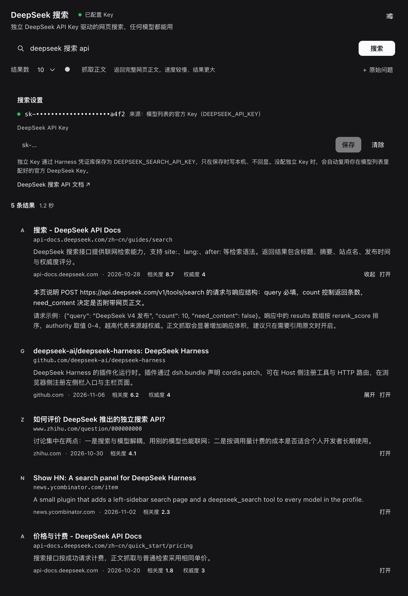
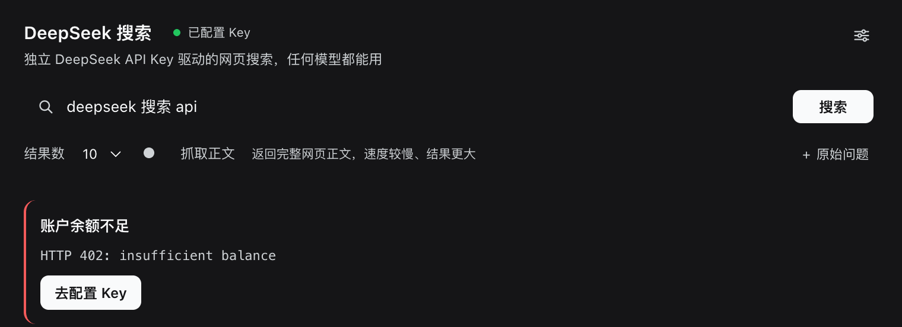

# DeepSeek 搜索 · `@sivancola/dsh-deepseek-search`

一个带**左侧栏入口**的 DeepSeek Harness 插件：用**独立的 DeepSeek API Key** 调用
[DeepSeek 官方 Search 接口](https://api-docs.deepseek.com/zh-cn/guides/search) 做网页搜索。

两半组成：

| 半边 | 作用 |
|---|---|
| **浏览器半边** | 左侧栏新增一个放大镜入口，点开是主栏里的完整搜索页：关键词、结果条数、正文抓取开关、结果卡片、Key 配置。 |
| **Host 半边** | 注册模型工具 `deepseek_search`，配置内的**任意模型 / 任意会话**都能直接调用；同时提供搜索页用的三个 HTTP 路由。 |

关键点：搜索走的是**本插件自己的 DeepSeek Key**，和当前对话所用模型的服务商（DeepSeek / Anthropic /
OpenAI 兼容 / 本地模型 …）完全无关。所以即使你用的是别的模型，也能用 `deepseek_search` 联网。

---

## 1. 已经安装好了

本插件已通过 `plugin_manager` 装进 `desktop` profile 并激活：

- 左侧栏第 4 个图标（在 Plugins / Schedules / Context 之后）→ **DeepSeek 搜索**
- 工具 `deepseek_search` 已对全部 agent 可见

装到了哪里：

```
/Users/work/Desktop/code/dsh-deepseek-search          # 源码（link 方式安装，改完即生效）
~/.dsh/profiles/desktop/package.json                  # dsh.profile.bundles 里多了 @sivancola/dsh-deepseek-search
```

重新安装 / 卸载：

```bash
# 卸载后重装（改了 package.json 或 cordis.patch.yml 时需要）
#   在 DSH 里：plugin_manager action=remove_bundle target=@sivancola/dsh-deepseek-search
#   然后：    plugin_manager action=install_bundle target=/Users/work/Desktop/code/dsh-deepseek-search
```

> 只改 `index.js` / `client.js` 的**代码**时，先 `set_bundle enabled=false` 再 `enabled=true` 即可热激活；
> 改 `package.json` / `cordis.patch.yml` / `locale/*` 需要 remove + install，必要时重启 App。

### 换台机器：从 npm 装（推荐）

已发布到 npm，包名 `@sivancola/dsh-deepseek-search`：

```
plugin_manager action=install_bundle target=@sivancola/dsh-deepseek-search
```

指定版本也可以：`target=@sivancola/dsh-deepseek-search@0.2.0`。

### 或者从 GitHub 装

```
plugin_manager action=install_bundle target=https://github.com/SivanCola/dsh-deepseek-search
```

也可以先 clone 再指向目录（本地目录是 link 安装，改完代码热激活即可）：

```bash
git clone https://github.com/SivanCola/dsh-deepseek-search.git
# plugin_manager action=install_bundle target=<clone 出来的目录>
```

### 界面预览

下面几张图是把本插件的**真实前端组件代码**（`client.js` 的 `SearchPage`）在浏览器里渲染后截的图，
只把 Host 返回的数据换成了示例内容：

<p>
  
  
</p>
<p>
  
  
</p>

错误态（这里以余额不足为例）：



> 截图里的结果条目是为了展示排版而编的示例数据，不是真实搜索结果。
> 这几张图的路径也登记在仓库根目录的 [`screenshots.json`](screenshots.json) 里，插件市场会优先读它。

---

## 2. Key 从哪来（四级回退，前两级就够了）

每次调用都重新解析，所以下面任何一处改动，**下一次调用立刻生效**，不用重启。优先级从高到低：

| 级别 | 来源 | 面板上显示 |
|---|---|---|
| 1 | `config.apiKey`（明文内联，仅调试用） | 配置文件内联 |
| 2 | **独立 Key**：Harness 凭证库里的 `DEEPSEEK_SEARCH_API_KEY` | 独立 Key |
| 3 | **官方 Key 自动复用**：你模型列表里配好的 DeepSeek Key（见下） | 模型列表的官方 Key（`DEEPSEEK_API_KEY`） |
| 4 | 环境变量 `DEEPSEEK_SEARCH_API_KEY` / `DEEPSEEK_API_KEY` | 环境变量 |

### 方式 0：什么都不配 —— 自动复用官方 Key（默认开）

插件会自己去读你已经在 Harness 里配好的 DeepSeek Key：

1. 问 `ctx.llm.listConfigurableProviders()` 要 provider 目录，挑出 `deepseek-official`；
2. 用 `ctx.settings.describe()` 读出这些 provider 命名空间（`llm-deepseek` /
   `web-deepseek-api` / `web-search-deepseek`）里的 `apiKeyEnv`；
3. 逐个走 `ctx.credentials.resolve()`，取第一个有值的；最后兜底 `DEEPSEEK_API_KEY`。

也就是说：**只要你模型列表里那个官方 DeepSeek 能用，这个插件的搜索就已经能用了**，不用再填一次 Key。
面板会显示「来源：模型列表的官方 Key（DEEPSEEK_API_KEY）」，可以直接看到复用的是哪一个凭证名。

关掉这个行为：

```yaml
config:
  useOfficialKey: false
```

> ⚠️ 只复用**Key**，不跟随官方 provider 的 `baseURL`。因为那个 baseURL 常常是本地/公司代理，
> 未必实现了 `/v1/tools/search`。要换接口地址请显式配 `baseUrl`。

### 方式 A：面板里填独立 Key（想要独立计费/换账号时就填）

点左侧栏的放大镜 → 右上角滑杆图标 → 密码框粘贴 `sk-...` → **保存**。状态从「未配置」变「已配置」，
并显示脱敏后的 `sk-abc…8f2c` 与来源。

Key 存进 **Harness 凭证库**，凭证名（credential ref）为 `DEEPSEEK_SEARCH_API_KEY`。填了就优先用它，
不会再动官方 Key —— 适合"搜索走另一个账号/额度"的场景。保存时写入本机，读回时不会回显原文。

### 方式 B：环境变量

```bash
export DEEPSEEK_SEARCH_API_KEY=sk-xxxx        # 然后重启 DSH
```

凭证服务会先查凭证库，再查进程环境 / `.env`，所以 A、B 共存时以 A 为准。

### 方式 C：写进插件 config

编辑 `~/.dsh/profiles/desktop/cordis.patch.yml` 中该 bundle 的 `config`（或在
`dsh-deepseek-search/cordis.patch.yml` 里取消注释），然后重装：

```yaml
config:
  apiKey: sk-xxxx        # 明文，优先级最高，仅适合临时调试
```

---

## 3. 用工具：`deepseek_search`

任何模型都能调，参数：

| 参数 | 类型 | 必填 | 说明 |
|---|---|---|---|
| `query` | string | 是 | 1–128 字符，不是全空白，支持下面的搜索语法 |
| `count` | integer | 否 | 1–50，默认 10 |
| `need_content` | boolean | 否 | true 时在 `content` 返回网页正文（更慢更大） |
| `ori_question` | string | 否 | 用户的原始问题，帮助理解搜索意图 |

`query` 里可以直接用 DeepSeek 的搜索语法（原样透传）：

| 语法 | 例子 | 说明 |
|---|---|---|
| `site:` | `DeepSeek site:github.com` | 限定站点，多个用 ` OR ` 连 |
| `-site:` | `DeepSeek -site:example.com` | 排除站点 |
| `-` / `-"…"` | `DeepSeek -广告`、`-"release notes"` | 排除词 / 排除短语 |
| `"…"` | `DeepSeek "精确短语"` | 精确匹配 |
| `lang:` | `DeepSeek lang:zh,en` | 限定语言 |
| `after:` / `before:` | `DeepSeek after:2025-01-01` | 限定发布时间 |

返回给模型的是紧凑文本（标题 / URL / 摘要），结构化结果是：

```json
{ "query": "…", "count": 10, "elapsedMs": 412,
  "results": [{ "title": "…", "url": "…", "snippet": "…", "summary": "…",
                "content": "", "siteName": "…", "siteIcon": "…",
                "date": "2026-06-01T00:00:00+00:00",
                "rerankScore": 2.4, "authority": 3 }] }
```

`authority`: -1 未知，0–4，「3 及以上」表示极权威；`rerankScore >= 1.5` 为优质结果（面板会给徽章）。

---

## 4. 可选配置项

`cordis.patch.yml` 的 `config` 全部可省略：

| 键 | 默认 | 说明 |
|---|---|---|
| `apiKey` | `''` | 明文 Key，优先级最高 |
| `apiKeyEnv` | `DEEPSEEK_SEARCH_API_KEY` | 凭证名 / 环境变量名 |
| `baseUrl` | `https://api.deepseek.com` | 接口 origin |
| `count` | `10` | 默认条数 1–50 |
| `needContent` | `false` | 默认是否抓正文 |
| `timeoutMs` | `25000` | 单次请求超时 |
| `toolName` | `deepseek_search` | 工具名，改名可避免和别的插件撞名 |

---

## 5. 实现结构

```
index.js          Host 半边：Cordis 插件，注册工具 + 3 个 POST 路由 + Key 四级解析
deepseek-api.js   纯函数 DeepSeek Search 客户端（无依赖，可单测）
official-key.js   纯函数：从 provider 目录 + settings 命名空间推导官方 Key 的凭证名
client.js         浏览器半边：sidebar.panellist 图标 + main 面板
locale/en.json    Plugins 页显示用的标题/描述
locale/zh.json
icon.svg
cordis.patch.yml  bundle patch，插入 id=dsh-deepseek-search 的 row
test/             node:test 单测（28 例，注入 fetchImpl，零联网）
SPEC.md           实现契约（服务签名、接口形状、错误码）
```

Host 提供、面板调用的路由（都是 `POST`，`cache-control: no-store`）：

| 路径 | 作用 |
|---|---|
| `/api/dsh-deepseek-search/status` | 是否已配置、脱敏 Key、来源、默认值 |
| `/api/dsh-deepseek-search/search` | 代理搜索，返回 `{ok:true,value:{…}}` 或 `{ok:false,error:{code,message}}` |
| `/api/dsh-deepseek-search/key` | 保存 / 清除凭证（`{apiKey:""}` 即清除） |

所有响应统一 `{ ok, value | error }`，错误码 `MISSING_API_KEY`、`UNAUTHORIZED`、`INSUFFICIENT_BALANCE`、
`FORBIDDEN`、`NOT_FOUND`、`TIMEOUT`、`RATE_LIMITED`、`BAD_REQUEST`、`NETWORK_ERROR`、`SERVER_ERROR`、
`BAD_RESPONSE`、`INTERNAL` —— 面板对每个码都有中英文提示。

设计取舍：

- **不接管 `ctx.web` 的 `searchProvider`。** 直接注册搜索 provider 会让 `web` 服务的
  「无配置 + 多个可用 provider → 模糊」判定被触发，可能打断你现有的 `web_search`。本插件改用
  独立工具 + 独立路由，零干扰。
- **Key 只留在 Host。** 浏览器永远只拿到脱敏串；搜索在 Host 侧发起，Key 不进前端、不进 localStorage。
- **每次调用现取 Key。** 不做缓存，所以在面板里换 Key 后下一次调用立刻生效，无需重启。

---

## 6. 测试

```bash
cd /Users/work/Desktop/code/dsh-deepseek-search
node --test test/*.test.mjs      # 28 passed（API 客户端 18 + 官方 Key 识别 10）
```

> Node 26 起 `node --test test/` 不再展开目录参数，用上面的 glob 形式（`npm test` 已内置）。

---

## 7. 排错

| 现象 | 原因 | 处理 |
|---|---|---|
| 提示 `HTTP 401: Authentication Fails ... ****534e is invalid`，并指出用的是「model provider settings 里的 DEEPSEEK_API_KEY」 | 自动复用到的官方 Key 已失效/被轮换 | 在模型列表里更新那把 Key，或在面板里填一把独立 Key（填了就不再动官方 Key） |
| 同上但指向「standalone key」 | 面板里那把 Key 无效 | 重新在面板保存 |
| `HTTP 402` | 那把 Key 所属账号余额不足 | 充值或换一把 |
| `HTTP 429` | 超过账号 QPS（Search 100/s） | 稍等重试，或减小 `count` |
| 提示「deepseek_search 未配置 Key」 | 既没有独立 Key，也没识别到官方 DeepSeek Key | 面板填一把，或确认模型列表里配的是 `deepseek-official` provider |

> 401 / 402 的提示会**明确点名实际用到的那把 Key**（例如 `DEEPSEEK_API_KEY` 还是 `DEEPSEEK_SEARCH_API_KEY`），
> 避免"明明没配独立 Key，却让你去面板改"的误解。

---

## 8. 已知限制

- 搜索/抓取按请求计费（DeepSeek 官方：每 1000 次成功请求 5 元，失败或空结果不计费）。
- QPS 按账号限：Search 100 QPS、Fetch 25 QPS，超限返回 429（面板会提示「稍等重试」）。
- 网页内容仍受目标站点可用性影响，`need_content` 也可能拿到空正文。
- 自动复用的只是官方 provider 的 **Key**，不跟随它的 `baseURL`；换接口地址请显式配 `baseUrl`。
- 需要真实有效 Key 才能验证的「有结果返回」这一步，取决于你账号的 Key 状态；插件侧的网络/鉴权链路已用真实
  请求验证过（能收到 DeepSeek 的 `request_id` 与业务错误码）。
- 面板在你当前主题下的最终视觉呈现未做像素级核验。

---

## 8. English summary

`@sivancola/dsh-deepseek-search` adds (a) a left-sidebar **DeepSeek Search** page and (b) a `deepseek_search`
tool available to **every** model in the profile. Both use the DeepSeek Search API
(`POST https://api.deepseek.com/v1/tools/search`) with the plugin's **own** API key, resolved per call
from an inline config value, the Harness credential store (`DEEPSEEK_SEARCH_API_KEY`) or the environment —
never from the model provider's key, and never sent to the browser. The plugin deliberately does **not**
register itself as the `ctx.web` search provider, so it cannot disturb an existing `web_search` setup.

---

[](https://github.com/deepseek-ai/deepseek-harness)
